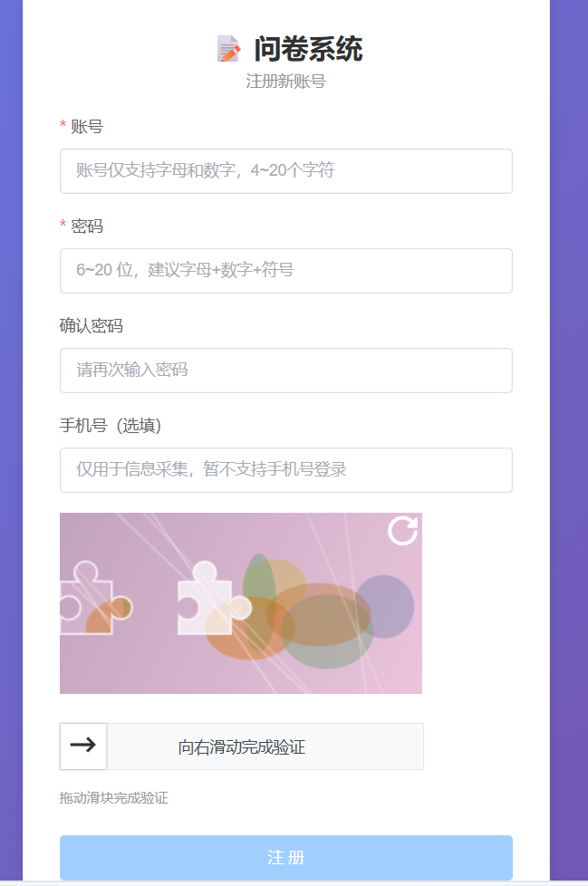
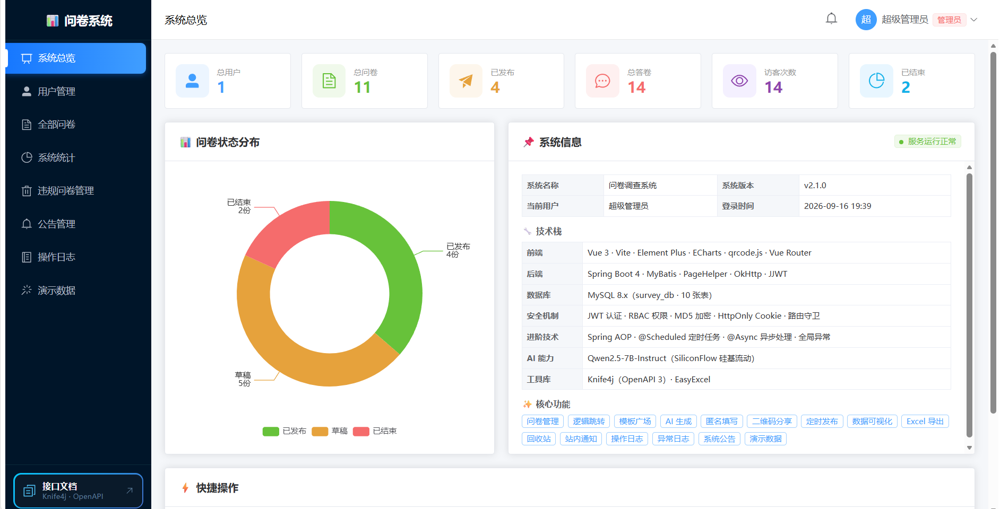
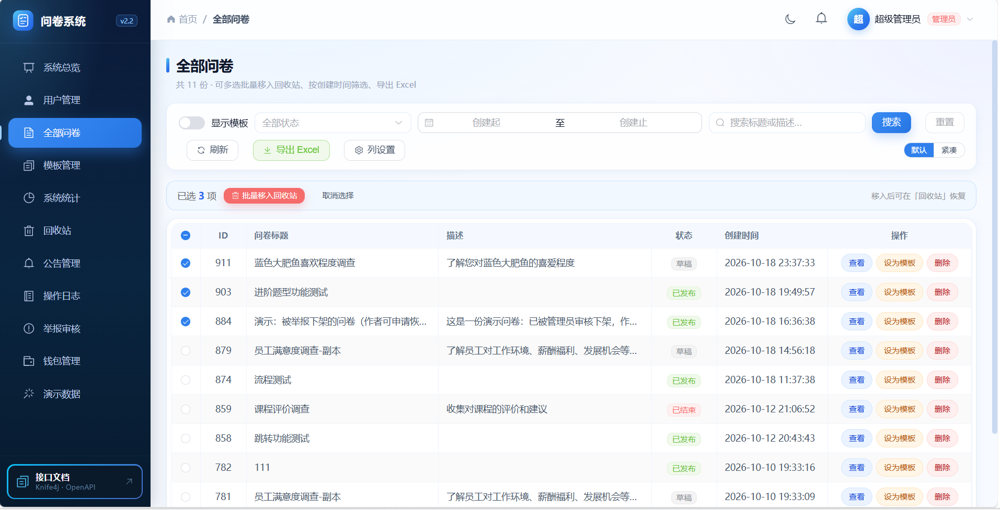
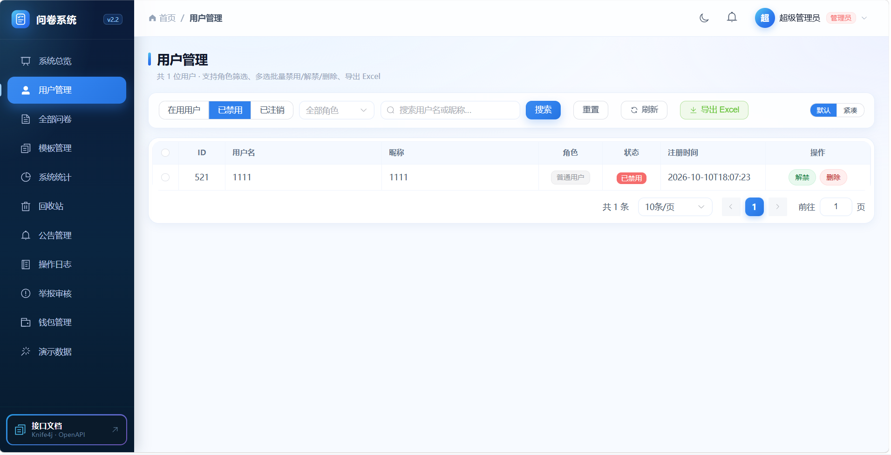
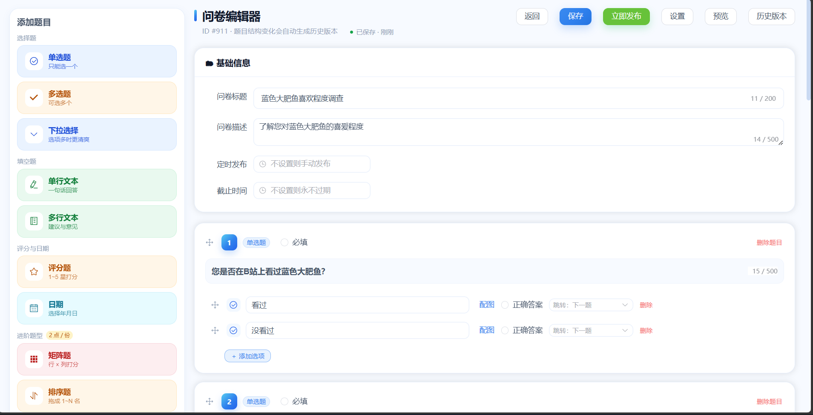
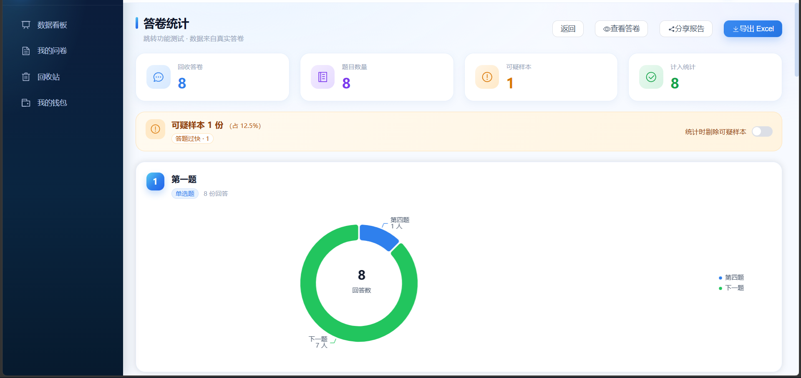
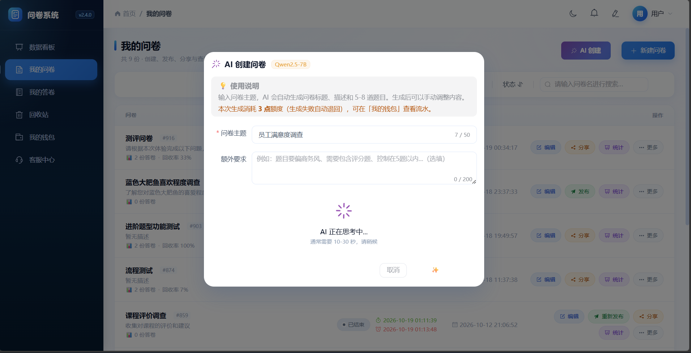
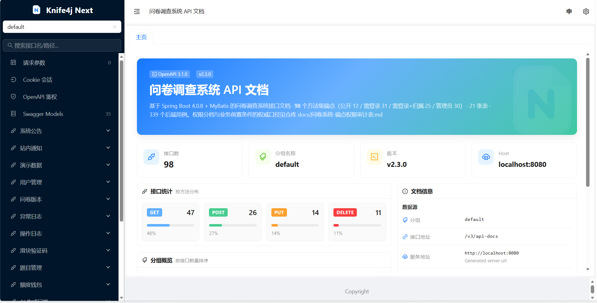

<div align="center">

# 📊 问卷调查系统

**基于 Spring Boot 4 + Vue 3 的前后端分离问卷调查系统**

[](https://github.com/xingchengal/survey-system/actions/workflows/ci.yml)
[](https://spring.io/projects/spring-boot)
[](https://vuejs.org/)
[](https://www.mysql.com/)
[](LICENSE)

一个功能完整的问卷调查平台：问卷设计与逻辑跳转、匿名/登录双通道填写、数据统计与 Excel 导出、
AI 生成问卷、账号与治理后台。

[30 秒速览](#-30-秒速览) · [功能特性](#-功能特性) · [技术栈](#-技术栈) · [系统架构](#-系统架构) · [快速开始](#-快速开始) · [项目结构](#-项目结构) · [接口文档](#-接口文档) · [界面截图](#-界面截图)

</div>

---

## ⚡ 30 秒速览

> 一个**能真的跑起来**的在线问卷系统：搭问卷（含逻辑跳转）→ 发链接 → 收答卷 → 看统计 → 导 Excel，全流程闭环；
> 管理端有 RBAC 权限矩阵、举报审核、额度钱包与批量治理。
>
> 规模：**105** 个 REST 端点 · **22** 张表 · **422** 个后端用例（49 类）· **22** 个前端页面。

**三个能对得上数字的点**

| # | 亮点 | 数字 |
|---|---|---|
| 1 | 统计接口加了 Redis 预聚合 | 2 万答卷下：单题分布 **QPS 140 → 2354（×16.8）**、P95 **284 → 30ms**；整份问卷统计 **27 → 984（×35.9）**。另有两条**未接缓存**的接口作对照，数字几乎不变 |
| 2 | Redis 挂了**不会放行**限流 | 熔断后每个请求 **12ms** 返回（不熔断时 ~4000ms/请求），限流退化为进程内计数 |
| 3 | 权限有**权威口径**且有测试钉住 | **105** 端点逐条分档（公开 13 / 需登录 34 / 归属 26 / 管理 32），MockMvc 全栈矩阵覆盖；**3** 个 CI 作业 |

**架构（一行版）**

```
浏览器 → Vue 3 SPA → JwtAuthFilter → RateLimitInterceptor → @RequireAdmin 切面 → Controller/Service → MySQL 8 + Redis
```

完整分层图与四条不变量见 [系统架构](#-系统架构)。

**跑起来**

```bash
cp .env.example .env      # Windows: copy .env.example .env
# 编辑 .env：DB_PASSWORD、JWT_SECRET（≥32 字符）、QWEN_API_KEY（可留空）
docker compose up --build
```

打开 <http://localhost:8080> → 注册一个账号 → `UPDATE t_user SET role='admin' WHERE username='你的账号';` 提权即可进管理端。

> 不想用 Docker？[快速开始](#-快速开始) 是四步手工流程（MySQL 8 + JDK 17 + Node 18+）。

---

## 📊 项目规模

| 维度 | 数量 |
|---|---|
| 后端主源文件 | **126** 个 Java 文件 |
| REST 端点 | **105** 个方法级端点（公开 13 / 需登录 34 / 需登录+归属 26 / 管理员 32） |
| 数据库 | **21** 张表（MySQL 8，库名 `survey_db`） |
| 后端测试 | **49** 个测试类 / **422** 个用例（默认全跑）＋ **2** 个真库测试（默认排除） |
| 前端 | `views/` **22** 个页面 · `api/` **15** 个模块 · **25** 条具名路由 |

---

## ✨ 功能特性

### 📋 问卷管理
- ✅ 问卷增删改查、一键复制、题目与选项动态增删调整
- ✅ **逻辑跳转**：条件（选项 → 目标题号）存真 `question.id`，删题或调序都不会错位
- ✅ **十种题型**：单选、多选、下拉、单行文本、多行文本、评分、日期、**矩阵、排序、NPS**（后三种属于「进阶题型包」）
- ✅ 状态机：草稿 → 已发布 → 已结束，配合 **定时发布** 与 **自动截止**（Spring `@Scheduled` 定时任务）
- ✅ **回收站**：软删除 → 移入回收站 → 恢复 / 彻底删除
- ✅ **模板广场**：31 个预置模板，7 大分类；可套用模板创建，也可把已有问卷标记为模板
- ✅ **模板热度**：记录每个模板被「从模板创建」的次数，模板广场与模板管理按热门排序、可看使用次数

### 🤖 AI 生成
- ✅ 输入一句话描述，由 **Qwen2.5-7B-Instruct**（硅基流动）生成完整问卷（题干 + 选项 + 题型）
- ✅ OkHttp 调用与数据库写入分离：外部 HTTP 调用在事务之外，DB 连接只在落库瞬间占用

### 🔗 发布与分享
- ✅ 一键发布并生成 **6 位分享码**，可复制分享链接、生成二维码
- ✅ 匿名答题页 `/s/:shareCode` 无需登录即可访问

### 📱 填写
- ✅ **匿名凭分享码作答**，**登录态作答**（同一套题目渲染，两条提交入口）
- ✅ 向导式填写，动态进度条
- ✅ **多选题"一选项一行"** 布局，长文案不挤在同一行
- ✅ **矩阵题**逐行单选、**排序题**上下移动调整名次、**NPS** 0~10 打分
- ✅ **登录用户对同一问卷只能提交一次**：应用层查重 + `t_answer` 唯一索引 `uk_survey_user` 兜底
- ✅ 匿名侧有意不做防重（避免误伤同一出口 IP 的 NAT 用户），改用 IP 限流控制刷量

### 📊 数据统计
- ✅ 单题分布（饼图 / 柱状图）、填空题文本、答卷列表与详情
- ✅ **矩阵题按行 × 列出表、排序题按平均名次排序、NPS 出净推荐值与 0~10 分布**
- ✅ **Excel 导出**（EasyExcel，中文文件名按 RFC 5987 编码，浏览器下载不乱码）
- ✅ 系统看板（管理员）、个人统计（问卷数 / 答卷数概览）

### 💳 额度钱包（模拟付费，不接真实支付）
- ✅ 注册赠送 10 点；发布 **-1** / AI 创建 **-3**（失败退回）/ 导出 **-1** / 高级设置包 **-1** / 协作者名额第 3 名起 **-1/人** / **进阶题型包 -2/份**
- ✅ 原子扣减（`UPDATE ... WHERE balance >= ?`）+ 幂等键（同一操作只扣一次）+ 管理端对账（`SUM(amount) = balance`）
- ✅ 价格唯一出处 `common/WalletFeature`，前端「计费规则」由 `GET /api/wallet/pricing` 动态渲染

### 👤 账号
- ✅ 注册 / 登录：**滑块验证码**（注册侧强制）、**双 token（access 12h + refresh 7d）**、「记住我」
- ✅ **401 自动静默续期并重放**：多请求并发过期只续期一次，续期失败才清登录态跳登录页
- ✅ 个人中心：**账号与昵称概念分离**、昵称 / 手机 / 邮箱修改、**自研头像裁剪（固定输出 320×320 PNG）** + 后端文件校验（格式 + 解码后 ≤ 2MB）
- ✅ 改密码、**登录日志与"最近登录"**、**账号注销（软删除，可被管理员恢复）**

### 🛡️ 治理
- ✅ **管理总览**：8 个真实指标（用户/问卷/答卷/访客/模板/举报/额度/今日新增）+ 近 7 天双线趋势 + 热门问卷 TOP5 + 待办直达
- ✅ 系统公告、站内通知、操作日志（AOP 自动记录）、异常日志（默认保留 90 天）
- ✅ **管理端批量操作**：全部问卷 / 用户管理 / 操作日志三页都支持**多选批量**（批量移入回收站、批量禁用解禁、批量删除、批量恢复）、**高级筛选**（时间范围、角色/级别、状态）与**导出 Excel**；全部问卷页另有列设置
- ✅ 用户管理：**在用 / 已禁用 / 已注销三视图**，已注销账号可恢复、已禁用账号可解禁；G3 起列表**含管理员**、支持角色筛选（`t_user.disabled`，禁用即刻踢下线）
- ✅ **演示数据**：一键生成 / 重置，方便演示与联调
- ✅ **限流 9 条规则**（内存固定窗口，命中返回 429）：登录 10/分/IP · AI 生成 1/30s/用户 · 匿名提交 30/分/IP · 登录提交 60/分/用户 · health 60/分/IP · 滑块取图 20/分/IP · 滑块判定 120/分/IP · refresh 30/分/IP · view 30/分/IP

### 🔐 安全
- ✅ **PBKDF2 加盐哈希**存密码，兼容历史 MD5 记录并在登录时自动升级
- ✅ **自研 JWT**（jjwt 0.12.6）+ 4 个 Filter，未引入 Spring Security
- ✅ **RBAC + `@RequireAdmin` 注解 + AOP 切面**，前端路由守卫只做体验层，权限防线全在后端
- ✅ **归属校验**：`OwnershipGuard` 统一判断资源是否属于当前用户
- ✅ **软删除**：每个查用户的 SQL 都带 `deleted_at IS NULL`，已注销账号不留任何后门
- ✅ **禁用标记**（`disabled`，与注销是两个概念）：登录与**每个请求**都校验，禁用即刻生效；保护"不能禁自己 / 不能禁用最后一个可用管理员"
- ✅ **`token_valid_after`**：改密码 / 恢复账号 / 禁用 / 解禁即作废此前签发的全部票据
- ✅ 接口文档用独立 `doc_token` 保护（HttpOnly + SameSite=Strict，`scope=doc` + `role=admin` 双校验，有效期 2 小时）
- ✅ 请求体上限 4MB，超限直接 413

---

## 🛠️ 技术栈

### 后端
| 技术 | 版本 | 说明 |
|---|---|---|
| **Spring Boot** | 4.0.8 | 核心框架（`spring-boot-starter-webmvc`） |
| **Java** | 17 | 语言版本 |
| **MyBatis** | 4.0.1 | ORM：**注解式 Mapper，无 XML** |
| **PageHelper** | 2.1.0 | 分页插件 |
| **MySQL** | 8.x | 数据库 `survey_db` |
| **Redis** | 7.x（本地用 Windows 5.0.14.1 构建） | 答卷统计**预聚合缓存** + **分布式限流**计数（Lettuce 客户端）。key 规范、失效策略与压测前后数据见 `docs/Redis-键规范与缓存限流设计.md` |
| **jjwt** | 0.12.6 | 自研 JWT 认证 |
| **Knife4j** | 5.6.1 | 接口文档（OpenAPI 3） |
| **EasyExcel** | 3.3.4 | Excel 导出 |
| **OkHttp** | 4.12.0 | HTTP 客户端（调用 AI） |
| **AspectJ** | — | AOP：操作日志、`@RequireAdmin` 鉴权 |
| **Maven Wrapper** | 3.9.16 | 构建工具（`mvnw` / `mvnw.cmd` 已入库） |

### 前端
| 技术 | 版本 | 说明 |
|---|---|---|
| **Vue** | 3.5 | 核心框架，**全项目 Option API，零 `<script setup>`**、无 Pinia / 无 TypeScript |
| **Vue Router** | 4.6 | 25 条具名路由 + 路由守卫 |
| **Element Plus** | 2.14 | UI 组件库 |
| **ECharts** | 6.1 | 数据可视化 |
| **qrcode** | 1.5 | 二维码生成 |
| **Vite** | 8 | 构建工具（dev 端口 5173，`/api` 代理到 8080） |
| **Node.js** | `^22.18.0` 或 `>=24.12.0` | 运行时要求（`package.json` 的 `engines`） |

---

## 🏗️ 系统架构

```
┌─────────────────────────────────────────────────────────────┐
│                        浏览器（用户端）                        │
│        管理员 · 普通用户 · 匿名访客                            │
└──────────────────────┬──────────────────────────────────────┘
                       │ HTTP / HTTPS
                       ▼
┌─────────────────────────────────────────────────────────────┐
│                 前端 · Vue 3 + Vite (5173)                   │
│  ┌──────────┬──────────┬──────────┬──────────┬──────────┐  │
│  │ 登录注册  │ 问卷管理  │ 问卷填写  │ 数据统计  │ 系统管理  │  │
│  └──────────┴──────────┴──────────┴──────────┴──────────┘  │
│              Vue Router（25 条路由） · Element Plus           │
│         开发期：Vite dev server + /api → 8080 反向代理         │
└──────────────────────┬──────────────────────────────────────┘
                       │ RESTful API（携带 JWT）
                       ▼
┌─────────────────────────────────────────────────────────────┐
│               后端 · Spring Boot 4 (8080)                    │
│  ┌──────────────────────────────────────────────────────┐   │
│  │  Filter 层：JwtAuthFilter · DocAccessFilter           │   │
│  │             RequestSizeFilter · HeaderRewrite         │   │
│  ├──────────────────────────────────────────────────────┤   │
│  │  拦截器：RateLimitInterceptor（9 条限流规则）           │   │
│  ├──────────────────────────────────────────────────────┤   │
│  │  AOP 层：LogAspect（操作日志）· AdminGuard（@RequireAdmin）│
│  ├──────────────────────────────────────────────────────┤   │
│  │  Controller 层：17 个控制器 / 105 个端点                │   │
│  ├──────────────────────────────────────────────────────┤   │
│  │  Service 层：业务逻辑 + @Scheduled 定时任务             │   │
│  ├──────────────────────────────────────────────────────┤   │
│  │  Mapper 层：MyBatis 注解式 Mapper（无 XML）            │   │
│  └──────────────────────────────────────────────────────┘   │
└──────────────────────┬──────────────────────────────────────┘
                       │
                       ▼
┌─────────────────────────────────────────────────────────────┐
│                    MySQL 8（survey_db）                      │
│  用户·登录日志·令牌·问卷·题目·选项·答卷·明细·公告·日志·通知     │
└─────────────────────────────────────────────────────────────┘
```

> **存储依赖**：MySQL 8（唯一的持久化存储）+ **Redis**（**旁路、可丢**：答卷统计**预聚合缓存**与**分布式限流计数**）。
> Redis 不可用时应用**照常启动与服务** —— 缓存退化为直查数据库、限流退化为单机计数
> （降级与熔断的方向见 `docs/Redis-键规范与缓存限流设计.md`）。

**部署形态**

| 场景 | 形态 |
|---|---|
| 开发 | IDEA 启动后端 **8080** + Vite 启动前端 **5173**，前端 `/api` 反向代理到后端 |
| 生产 | **单包部署**：前端 `npm run build` 产物 `dist` 拷进后端 `static/`，前后端同源，只需一个进程与一个端口 |

**配置分层**

| 文件 | 入库 | 说明 |
|---|---|---|
| `application.yaml` | ✅ | 主配置：端口、数据源占位符、MyBatis、PageHelper、Knife4j、AI、JWT 默认值；`spring.profiles.default=local` |
| `application-local.yml` | ❌ **已 gitignore** | 本地开发配置：数据库口令、JWT 密钥、AI Key 都放这里，**不入库** |
| `application-prod.yml` | ✅ | 生产配置：HikariCP 连接池、`@Async` 线程池、错误页信息脱敏、文件日志滚动 |

---

## 🚀 快速开始

### 环境要求

| 工具 | 版本 |
|---|---|
| JDK | 17+ |
| Node.js | `^22.18.0` 或 `>=24.12.0` |
| MySQL | 8.0+ |
| Maven | 无需安装，用仓库自带的 Maven Wrapper（3.9.16） |

### 1️⃣ 初始化数据库

```sql
CREATE DATABASE survey_db CHARACTER SET utf8mb4 COLLATE utf8mb4_unicode_ci;
```

然后导入建表脚本（位于**仓库根目录的 `sql/`**，不是后端模块下）：

```bash
mysql -u root -p --default-character-set=utf8mb4 survey_db < sql/init.sql
```

脚本一次性建好 **22 张表**。它只含表结构、**不含业务数据**，所以建完库还有两步：

1. **创建管理员**：系统没有管理员种子数据 —— 先在前端注册一个账号，再执行
   ```sql
   UPDATE t_user SET role = 'admin' WHERE username = '你的账号';
   ```
2. **补内置模板**（可选）：模板广场初始为空，用管理员账号调用一次幂等接口补回 31 个模板：
   ```bash
   curl -X POST http://localhost:8080/api/template-seeder/init
   ```
   该接口在 `prod` profile 下不注册，请在本地调用。

### 2️⃣ 配置后端

在 `survey-backend/src/main/resources/` 下新建本地配置文件 `application-local.yml`（该文件已被 `.gitignore` 排除，不会入库），至少覆盖这三项：

| 配置项 | 说明 |
|---|---|
| `spring.datasource.username` / `password` | 本地 MySQL 账号口令 |
| `jwt.secret` | JWT 密钥，**至少 32 个字符**；缺失时后端启动即失败（有意为之） |
| `ai.qwen.api-key` | 硅基流动 API Key，不用 AI 功能可留空 |

主配置 `application.yaml` 已设 `spring.profiles.default=local`，所以在 IDEA 里直接 Run 即可生效；
生产部署请显式加 `--spring.profiles.active=prod`，否则会读本地配置。

### 3️⃣ 启动后端

```powershell
cd survey-backend
.\mvnw.cmd -o clean compile
.\mvnw.cmd spring-boot:run
```

后端启动在 **`http://localhost:8080`**。

### 4️⃣ 启动前端

```bash
cd survey-frontend
npm install
npm run dev
```

前端启动在 **`http://localhost:5173`**（`/api` 请求由 Vite 代理到 8080）。

### 5️⃣ 登录系统

- **管理员**：由上方"初始化数据库"的 `UPDATE t_user SET role='admin'` 指定，生产环境请立即改密码
- **普通用户**：在注册页自行注册（注册需通过滑块验证码）

---

## 🐳 Docker 一键启动（演示 / 答辩推荐）

数据库（MySQL）、**Redis**、后端、前端一起起；前端 `dist` 已打进 jar，所以**应用只有一个容器**：

```bash
copy .env.example .env      # Git Bash: cp .env.example .env
# 编辑 .env：DB_PASSWORD、JWT_SECRET（≥32 字符）、QWEN_API_KEY（可留空）
docker compose up --build
```

首次构建要几分钟（下载 Node 与 Maven 依赖并完整编译一次），之后 `docker compose up` 秒起。

| 项 | 说明 |
|---|---|
| 应用地址 | <http://localhost:8080> —— 前端与接口同源，不需要再跑 Vite |
| 数据库 | 容器内 3306，宿主机映射 **3307**（避开本机已装的 MySQL） |
| Redis | 容器内 6379，宿主机映射 **6380**（避开本机 6379）。只承载统计缓存与限流计数，**不持久化**：它挂了应用照常服务（缓存回源、限流退化为单机计数） |
| 建表 | 首次启动自动执行 `sql/init.sql`（22 张表 + 唯一索引） |
| 数据持久化 | 存在 `survey-mysql-data` 卷里：`docker compose down` 不丢，`down -v` 才清空 |
| 建管理员 | 先注册账号，再 `UPDATE t_user SET role='admin' WHERE username='你的账号';` |
| 改了代码 | 重新 `docker compose up --build` |

> 只想要"一个进程"的本地形态也可以不用 Docker：把 `npm run build` 的 `dist/*` 拷进
> `survey-backend/src/main/resources/static/`，然后只跑后端 `8080`。

## 📁 项目结构

```
IdeaProjects/
├── README.md                          # 本文件
├── sql/                               # 数据库脚本
│   └── init.sql                       # 建库建表（22 张表，仅结构）
├── docs/                              # 随仓库入库的文档（见下方"文档索引"）
│   ├── README.md
│   ├── 问卷系统-端点权限审计表.md
│   └── ...
│
├── survey-backend/                    # 后端服务
│   ├── mvnw / mvnw.cmd                # Maven Wrapper 3.9.16
│   ├── src/main/java/com/survey/
│   │   ├── annotation/                # 自定义注解（@OperationLog、@RequireAdmin）
│   │   ├── aspect/                    # AOP 切面（操作日志、管理员鉴权）
│   │   ├── common/                    # 通用类（PageResult、OwnershipGuard、枚举、校验器）
│   │   ├── config/                    # 配置类（Knife4j、CORS、限流、全局异常、SPA 转发）
│   │   ├── controller/                # 控制器（13 个）
│   │   ├── dto/                       # 请求 DTO（@Valid 校验）
│   │   ├── entity/                    # 实体类（12 个）
│   │   ├── filter/                    # 过滤器（JWT、文档保护、请求体上限）
│   │   ├── mapper/                    # 数据访问层（注解式 Mapper，12 个）
│   │   ├── service/                   # 业务逻辑层（15 个）
│   │   └── util/                      # 工具类（JwtUtil、WebUtils）
│   ├── src/main/resources/
│   │   ├── application.yaml           # 主配置
│   │   ├── application-local.yml      # 本地配置（已 gitignore，不入库）
│   │   └── application-prod.yml       # 生产配置
│   ├── src/test/java/com/survey/      # 测试（49 个类 / 422 例；另 2 个真库测试默认不跑）
│   └── pom.xml
│
└── survey-frontend/                   # 前端应用
    ├── src/
    │   ├── api/                       # 接口模块（12 个，http.js 统一封装 401 续期）
    │   ├── components/                # 公共组件（头像裁剪等）
    │   ├── layouts/                   # 布局组件
    │   ├── router/                    # 路由配置（25 条具名路由 + 守卫）
    │   ├── styles/                    # 全局样式
    │   ├── utils/                     # 工具（登录态读写、请求工具）
    │   ├── views/                     # 页面（17 个）
    │   ├── App.vue
    │   └── main.js
    ├── public/
    ├── package.json
    └── vite.config.js
```

---

## 📚 接口文档

启动后端后访问 Knife4j（OpenAPI 3）文档：

- **开发环境**：<http://localhost:8080/doc.html>
- 文档路径由 `DocAccessFilter` 保护：仅 **管理员** 可访问，后端在管理员登录时下发独立的 `doc_token` Cookie
  （HttpOnly + SameSite=Strict，`scope=doc` + `role=admin` 双校验，有效期 2 小时）；非管理员访问返回 403
- **生产环境**：默认关闭

### 核心接口

| 模块 | 接口 | 说明 |
|---|---|---|
| **认证** | `POST /api/user/register` | 注册（需滑块验证码凭证） |
| **认证** | `POST /api/user/login` | 登录，返回 access token（勾选"记住我"再返回 refresh token） |
| **认证** | `POST /api/user/refresh` | 用 refresh token 换取新的 access token（一次性轮换） |
| **问卷** | `GET /api/survey/my` | 我的问卷列表 |
| **问卷** | `POST /api/survey/publish/{id}` | 发布问卷并生成分享码 |
| **问卷** | `GET /api/survey/templates` | 模板广场列表 |
| **填写** | `GET /api/survey/share/{shareCode}` | 通过分享码查询问卷（匿名可访问） |
| **提交** | `POST /api/answer/submit-share/{shareCode}` | 匿名提交答卷 |
| **提交** | `POST /api/answer/submit/{surveyId}` | 登录态提交答卷（同一用户同一问卷仅一次） |
| **统计** | `GET /api/answer/statistics/{questionId}` | 单题选项分布统计 |
| **统计** | `GET /api/answer/texts/{questionId}` | 填空题文本列表 |
| **导出** | `GET /api/answer/export/{surveyId}` | 导出 Excel（中文文件名） |
| **AI** | `POST /api/ai/generate` | AI 生成问卷 |

完整接口请查看 Knife4j 文档，或查阅 [`docs/问卷系统-端点权限审计表.md`](docs/问卷系统-端点权限审计表.md)
（**105** 个方法级端点的权限分档与业务前置条件的权威口径）。

---

## 🎯 技术亮点

### 1. 逻辑跳转（有向无环图）
- 跳转条件存**真实的 `question.id`**（不是题号下标），删题、调序后依然指向同一道题
- 单选 / 多选条件跳转，OR 逻辑 + 顺序优先
- 前端按跳转条件动态计算作答路径，避免死循环

### 2. 双 token + 401 静默续期
- `access token` 12 小时（JWT，无状态）+ `refresh token` 7 天（入库、可吊销、一次性轮换）
- 前端 `api/http.js` 收到 401 时自动调 `/api/user/refresh` 换票并**重放**原请求，用户无感
- 并发过期只发一次续期请求，避免"一次性轮换"互相踩踏
- 改密码 / 恢复账号时写入 `token_valid_after`，一次性作废此前签发的全部票据

### 3. 软删除与账号可恢复
- 问卷回收站用 `t_survey.deleted` 标记（并记录 `deleted_by`，页面上能看到"谁删的"），**彻底删除**才级联清理题目 / 选项 / 答卷 / 明细
- 用户注销用 `t_user.deleted_at` 时间戳标记，每个查用户的 SQL 都带 `deleted_at IS NULL`，注销账号在鉴权链路里等价于不存在
- 管理员可在"已注销"视图中恢复账号，恢复后旧票据依旧无效（令牌生效起点被推后）

### 4. 多层鉴权
- JWT 过滤器（认证）→ `@RequireAdmin` + AOP（角色）→ `OwnershipGuard`（归属）→ MyBatis 查询条件（软删除）
- 前端路由守卫只负责不显示越权菜单，**真正的权限防线全在后端**

### 5. 内存限流 9 条规则
- `RateLimitInterceptor` 固定窗口计数，按 IP 或按用户维度区分
- 公开接口（登录、AI、匿名提交、滑块、health、view）逐一配额，命中直接 429
- 登录接口按**真实连接地址**计数，不用可伪造的 `X-Forwarded-For`

### 6. Spring AOP 操作日志
- 自定义 `@OperationLog` 注解 + 切面自动落库，异步写入不阻塞主业务
- 全局异常处理统一响应格式，异常异步写入 `t_error_log`，默认保留 90 天，前端页面可直接查看堆栈

### 7. 定时任务
- `@Scheduled` 每分钟扫描：到点自动发布草稿问卷、超期自动结束已发布问卷

### 8. 性能基线（2026-10-18 复测：2 万答卷 / 12 万明细）

同一份夹具、同一台机器，**只切换 `APP_CACHE_STATS_ENABLED`** 跑两组对照：

| 接口 | 无缓存 QPS | 有缓存 QPS | 提升 | P95（无 → 有） |
|---|---|---|---|---|
| 单题选项分布 `statistics/{qid}` | 140.3 | **2353.8** | **×16.8** | 284ms → 30ms |
| 整份问卷统计 `statistics/survey/{sid}`（8 题一次取回） | 27.4 | **984.3** | **×35.9** | 328ms → 10ms |
| 答卷数 `count/{sid}` | 1266.3 | 2912.9 | ×2.3 | 41ms → 22ms |
| 填空文本 `texts/{qid}`（2 万行取前 2000） | 598.9 | 1135.5 | ×1.9 | 39ms → 21ms |
| 答卷列表分页 `list/{sid}`（**未接缓存**，对照组） | 904.5 | 834.6 | ×0.9 | 10ms → 12ms |
| 我的统计 `my-statistics`（**未接缓存**，对照组） | 462.0 | 464.9 | ×1.0 | 41ms → 40ms |

★ **两个对照组（最后两行）几乎不变**，这正是这批数字可信的原因 —— 它排除了"有缓存那轮恰好机器更闲"
这类环境噪声，差异只能来自缓存本身。

★ 为什么"整份问卷统计"提升最大（×35.9）：它一次取回 8 道题的分布，缓存前要扫 8 × 2 万行明细；
缓存后整份结果一次命中。第 24 轮把"逐题请求"合并成"一次取回"的收益，在这里被放大。

**测试条件**（可复现；工具已入库在 [`tools/bench/`](tools/bench/README.md)）：

- 夹具：1 份问卷 / 8 题（3 单选 + 3 多选 + 2 填空）/ 2 万匿名答卷 / 12 万明细，灌入耗时 **2.5 秒**
- 客户端：`Bench.java`（JDK 自带 `HttpClient`，零第三方依赖），并发 8~32、每轮 300~2000 请求、预热 100
- 环境：本机 Windows、JDK 17、MySQL 8 单实例、Redis 5 本机；**单实例、无反向代理**
- 对照方法：`APP_CACHE_STATS_ENABLED=false` 起第二个实例（8082），同一份 token 打同一批接口

---

## 📸 界面截图

### 登录页


账号 + 密码登录，配合"记住我"下发 7 天 refresh token；登录失败只给统一文案（不区分账号不存在与密码错误），避免账号探测。★ 登出会**精确吊销这一枚** refresh token（其它设备不受影响），而不带 token 的登出会吊销该用户全部。

### 注册页（含滑块验证码）


注册需填写账号、密码、昵称与手机号，并**先通过滑块验证码**才能提交；账号限定 4~20 位字母数字，密码 6~20 位。滑块由后端出题与判定（凭证 60 秒过期、一次性使用），注册页因此不需要登录态。

### 系统总览（运营驾驶舱）


8 个**真实指标**（总用户 / 总问卷 / 总答卷 / 访客次数 / 在架模板 / 待处理举报 / 全站额度 / 今日新增）+ 问卷状态分布 + 近 7 天"新建问卷 / 收到答卷"双折线 + 热门问卷 TOP5 + 运营待办直达。数据全部来自单条聚合 SQL（无 N+1），今日趋势按自然日补齐 7 天。

### 全部问卷（多选批量治理）


勾选多行后浮出**批量操作条**（批量移入回收站），配合创建时间范围筛选、列设置（本地记忆）与导出 Excel。批量动作是**逐条调单条端点**（`allSettled`）—— 能精确回报"哪几份成功、哪几份为什么失败"，而不是整批回滚；导出走后端 EasyExcel，上限 1 万行且**超出明确拒绝**（不静默截断）。

### 用户管理（在用 / 已禁用 / 已注销）


三个分类视图，列表**含管理员**，支持角色筛选与批量禁用/解禁/删除/恢复。禁用是独立于"注销"的处置：写 `t_user.disabled` 的**同时**推进 `token_valid_after`，所以**瞬间生效**（不是等 12 小时）；保护规则是"不能禁用自己"与"不能禁用最后一个**可用**管理员"（`countActiveAdmins()`，不是 `countAdmins()`）。

### 问卷编辑器（全屏 + 左侧题型面板）


左侧题型面板直接拖入，右侧编辑题目与选项；支持单选、多选、下拉、单行/多行文本、评分、日期、矩阵、排序、NPS 等题型（矩阵/排序/NPS 属进阶题型包）。每道题可配置**逻辑跳转**——条件存真实 `question.id`，删题或调序都不会错位；另有历史版本 / 对比 / 回滚。

### 数据统计（含答卷质控）


顶部四个指标（回收答卷 / 题目数量 / **可疑样本** / 计入统计），可按开关把可疑样本剔除后再统计；可疑样本由四条规则打标（答题过快 / 直线作答 / 答案不在选项里 / 同题干矛盾），**只打标不删除**。图表之外还有答卷列表、单份详情、分享报告与导出 Excel（中文文件名按 RFC 5987 编码，下载不乱码）。

### AI 生成问卷


输入一句话描述，由 Qwen（硅基流动）生成完整问卷，题干、选项、题型一并给出，生成后可直接进入编辑器继续调整；接口按"1 次/30 秒/用户"限流，防止真实计费的调用被脚本刷爆。

### 接口文档


Knife4j（OpenAPI 3）在线文档，覆盖全部 **105** 个方法级端点；文档路径由独立 `doc_token` Cookie 保护（HttpOnly + SameSite=Strict，`scope=doc` 与 `role=admin` 双校验），非管理员访问返回 403。

---

## 📝 开发说明

### 📖 文档索引

| 文档 | 说明 |
|---|---|
| [`docs/README.md`](docs/README.md) | 文档目录索引与同步规则 |
| [`docs/问卷系统-端点权限审计表.md`](docs/问卷系统-端点权限审计表.md) | ★ **端点与权限的权威口径**：105 个方法级端点的权限分档、业务前置条件、可复现的审计命令 |

### 数据库表结构

| 表名 | 说明 |
|---|---|
| `t_user` | 用户表（含 `deleted_at` 软删除、`token_valid_after` 令牌生效起点） |
| `t_login_log` | 登录日志表 |
| `t_refresh_token` | 刷新令牌表（一次性轮换，`uk_token_hash` 唯一索引） |
| `t_survey` | 问卷表（含分享码、发布/截止时间、访问量；`deleted` + `deleted_by` 标记回收站） |
| `t_question` | 题目表 |
| `t_option` | 选项表 |
| `t_answer` | 答卷表（`uk_survey_user` 唯一索引兜底防重） |
| `t_answer_detail` | 答题明细表 |
| `t_announcement` | 系统公告表 |
| `t_notification` | 站内通知表 |
| `t_operation_log` | 操作日志表 |
| `t_error_log` | 异常日志表（默认保留 90 天，可用 `log.retention-days` 覆盖） |

### 关键配置

| 配置项 | 位置 | 说明 |
|---|---|---|
| 数据库账号口令 | `application-local.yml` | 本地配置，不入库 |
| JWT 密钥（`jwt.secret`） | `application-local.yml` | 至少 32 字符，生产环境务必更换；缺失时启动失败 |
| Qwen API Key（`ai.qwen.api-key`） | `application-local.yml` | 硅基流动申请，不用 AI 可留空 |
| 连接池 / 异步线程池 / 错误页脱敏 | `application-prod.yml` | 生产专用 |
| 异常日志保留天数 | `log.retention-days` | 默认 90 |

### 后端测试

```powershell
cd survey-backend
.\mvnw.cmd -o test
```

覆盖 **422** 个默认用例（共 **49** 个测试类），全部**不依赖数据库**（纯单测 + 1 个 MockMvc 全栈类，
后者把 Mapper 与 DataSource 都 mock 掉）。三个需要真实 MySQL 的类已在 Surefire 中排除：

```powershell
# ① contextLoads（连本机 survey_db，只验证 Spring 上下文能起来）
.\mvnw.cmd -o "-Dtest=SurveyBackendApplicationTests" test

# ② 真库集成测试：注册→建卷→发布→提交→统计→分页→Excel→删除（只连独立的空库 survey_db_test）
$env:TEST_DB_PASSWORD='<本机库口令>'
.\mvnw.cmd -o "-Dtest=SurveyFlowIntegrationTest" test

# ③ 钱包并发测试（50 并发扣费不超扣 / 同幂等键只扣一次 / 对账一致）
.\mvnw.cmd -o "-Dtest=WalletConcurrencyTest" test
```

**覆盖率（JaCoCo，可选 profile）**

```powershell
# 生成 target/site/jacoco/（html + xml + csv）
.\mvnw.cmd -B -Pcoverage test
```

> jacoco 放在 pom 的 **`coverage` profile** 里、**默认不启用** —— 本地日常是离线构建
> （`-o test`），把插件无条件挂上去会让 `-o` 直接失败（多数人 `~/.m2` 里没有它）。
> 首次用 `-Pcoverage` 需要联网拉一次插件；之后可离线。

上一轮实测（**359 例**时点；当前 422 例未复测覆盖）：**行 60.1% · 分支 50.7% · 指令 59.7%**。分包看更能说明问题：

| 包 | 行覆盖 | 说明 |
|---|---|---|
| `common` / `aspect` | **91% / 90.7%** | 核心不变量（角色、归属、状态枚举、限流、脱敏）—— 这才是必须钉死的部分 |
| `service` | **68.3%** | 业务主干；从 52.5% 提上来的主要动作是补了 `UserService` 的 9 个实例方法（原来只测静态哈希） |
| `config` / `filter` | 64.5% / 64.3% | 过滤器链与 Redis 熔断 |
| `controller` | 16.3% | 主要是参数转发；**鉴权路径**由 MockMvc 矩阵逐条覆盖，业务分支在 Service |

> **统计口径**：jacoco 排除了 4 个「没有可断言的业务分支」的类 ——
> `TemplateSeederService` / `DemoDataService`（一次性播种，方法体基本是批量 insert）、
> `AiGenerateService` / `QwenClient`（外部 HTTP 调用，要验的是超时降级，属于集成测试）。
> 排除它们后是 60.1%；**含它们时约 52.9%** —— 两个数字都写在配置注释里，不藏着。

CI 的 backend 作业跑 `-Pcoverage`，把报告作为 artifact 上传，并在 job summary 里输出上面这组数字。
**不设强制阈值**：覆盖率是看趋势的指标，用阈值卡 CI 只会逼人写凑数的测试。

> 集成测试的库要先建好并导入结构（`sql/init.sql`），且**不要**指向开发/演示库：
> `CREATE DATABASE survey_db_test ...` → `mysql ... survey_db_test < sql/init.sql`。
> CI 里由 GitHub Actions 的 MySQL 8 service 自动完成这一步。

---

## 🤝 贡献指南

欢迎提 Issue 和 PR！

1. Fork 本项目
2. 新建分支 `git checkout -b feature/xxx`
3. 提交更改 `git commit -m "feat: xxx"`
4. 推送 `git push origin feature/xxx`
5. 提交 Pull Request

---

## 📄 License

[MIT](LICENSE) © 2026

---

## 🙏 致谢

- [Spring Boot](https://spring.io/projects/spring-boot)
- [Vue.js](https://vuejs.org/)
- [Element Plus](https://element-plus.org/)
- [Knife4j](https://doc.xiaominfo.com/)
- [SiliconFlow](https://siliconflow.cn/)

---

<div align="center">

**⭐ 如果这个项目对你有帮助，请给个 Star ⭐**

</div>
